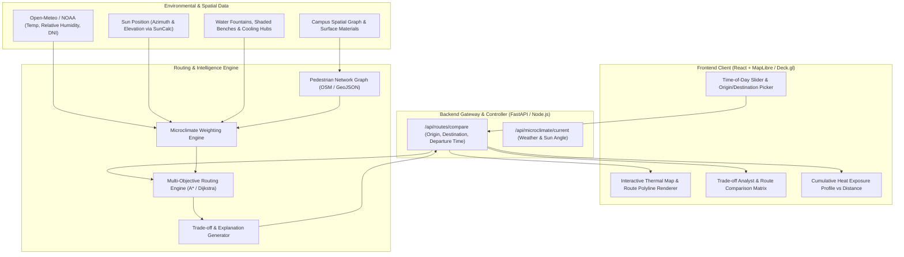
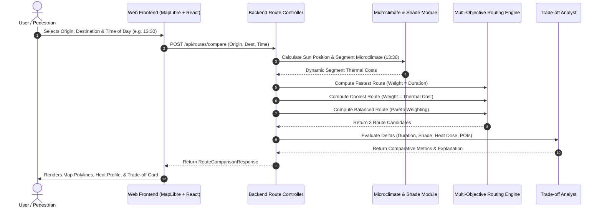

# System Architecture & Technical Specification: CoolPath (Thermal-Resilient Route Planner)

> **Hackathon Problem Statement:**
> *"Recommend walking or work routes that reduce heat exposure, while explaining the trade-off against travel time. Heat exposure varies with time of day, surface temperature, shade, humidity, and access to water or rest points."*
>
> **Project Scope:** One defined Campus or Urban District Zone (e.g., University Campus or Downtown 2 km × 2 km). Compare at least two routes (*Fastest Route* vs. *Coolest Route* / *Balanced Route*) with transparent trade-off metrics.

---

## 1. System Overview & Architecture Diagram

CoolPath is a micro-climate-aware spatial routing system. Unlike conventional navigation engines (e.g., Google Maps, OSRM) that solely minimize distance or travel duration, CoolPath treats **thermal exposure as an accumulated cost penalty** and **cooling amenities (shade, water refill points, AC indoor rest corridors) as recovery offsets**.



---

## 2. Technology Stack & Decision Rationale

| Layer | Recommended Technology | Why for this Hackathon? |
| :--- | :--- | :--- |
| **Frontend Framework** | **React / Next.js (TypeScript) + Tailwind CSS + Lucide Icons** | Instant developer velocity, rich reactive state for time sliders and routing comparisons. |
| **Map Rendering** | **MapLibre GL JS / Mapbox GL JS** + **Deck.gl** | WebGL-accelerated rendering capable of displaying vector tile base layers, dynamic tree shade polygons, surface heat tints, and dual/triple route comparison paths without lag. |
| **Visual Charts** | **Recharts** | Smooth rendering of the "Thermal Exposure Profile" (X-axis: distance/time, Y-axis: Heat Index / WBGT). |
| **Backend API** | **Python (FastAPI)** *or* **Node.js / TypeScript (Express)** | FastAPI is ideal if leveraging Python's scientific ecosystem (`networkx`, `geopandas`, `shapely`, `scipy`). Node.js is great if building a full-stack mono-repo with `turf.js`. |
| **Graph & Routing Engine** | **NetworkX (Python)** or **Custom Multi-Weighted Dijkstra (TS/Python)** | Campus/District network has ~300 to 2,000 nodes. In-memory graph processing computes multiple route variants in < 15ms. |
| **Solar & Shade Modeling** | **SunCalc (Astronomical Solar Position library)** | Computes real-time solar azimuth and solar altitude for any simulated time of day without heavy simulation overhead. |
| **Weather & Microclimate Data** | **Open-Meteo Free API (Hourly Weather)** + Surface Albedo Constants | Live/historical ambient temperature, direct normal irradiance (DNI), and relative humidity without requiring an API key. |
| **Base Spatial Data** | **OpenStreetMap (OSM) via Overpass API / GeoJSON** | Free download of pedestrian walkways, building footprints (with building height tags), tree canopies, and water fountain POIs for the chosen zone. |

---

## 3. Project Boundaries & Scope Control

To deliver an exceptional, bug-free prototype in a hackathon setting, the boundaries must be firmly delineated:

### In-Scope (Hackathon Deliverables)
1. **Target Zone**: One curated 1–4 $\text{km}^2$ boundary (e.g., University Campus or Central Tech/Civic Park).
2. **Dynamic Time-of-Day Dimension**: Interactive slider allowing users to test routes at 08:00 (cool morning), 13:30 (peak solar irradiance & asphalt heat), or 18:00 (cooling evening).
3. **Route Comparison**: Generates and visually compares at least two (or three) routes:
   - **Route A: Fastest Route** (Distance/speed optimized, heat agnostic).
   - **Route B: Coolest Route** (Prioritizes shade, tree cover, low-albedo surfaces, water access).
   - **Route C: Balanced Route** (Pareto-optimal trade-off: slight 2–4 min detour for 30–50% heat reduction).
4. **Trade-off Explanation Engine**: Clear quantitative comparisons:
   - *Time delta*: $+3\text{ min } (+18\%)$
   - *Thermal stress delta*: $-42\%$ cumulative heat exposure
   - *Amenity benefits*: Passes 2 chilled water refill points and 1 indoor air-conditioned corridor.
5. **Simulated/Derived Microclimate**:
   - Surface temperatures inferred from surface type (asphalt vs. grass vs. white pavement vs. brick) + solar exposure.
   - Dynamic building shadow projection based on solar elevation/azimuth and building heights.

### Explicitly Out-of-Scope
- Worldwide global turn-by-turn routing (requires massive OSRM cluster).
- Real-time deployment of physical IoT sensor networks on site (simulated or API-ingested telemetry is used instead).
- Dynamic vehicular traffic congestion (pedestrian/micro-mobility focus only).
- Turn-by-turn voice guidance or native mobile App store compilation.

---

## 4. Data Models & Schemas

### 4.1. Graph Node (Intersection / Waypoint)
```typescript
interface GraphNode {
  id: string;                      // e.g. "node_104"
  latitude: number;
  longitude: number;
  elevationMeters?: number;
  amenity?: 'water_fountain' | 'shaded_bench' | 'cooling_center' | 'indoor_pass' | null;
}
```

### 4.2. Graph Edge (Walkway / Path Segment)
```typescript
interface GraphEdge {
  id: string;                      // e.g. "edge_104_105"
  sourceNodeId: string;
  targetNodeId: string;
  lengthMeters: number;
  baseWalkSpeedMps: number;        // Default: 1.3 m/s (~4.7 km/h)
  surfaceType: 'asphalt' | 'concrete' | 'brick' | 'gravel' | 'grass' | 'indoor';
  surfaceAlbedo: number;           // e.g., asphalt = 0.10, grass = 0.25, white pavers = 0.60
  treeCanopyCoverPct: number;      // 0.0 to 1.0 (foliage coverage)
  isIndoorAC: boolean;             // True if walking through an air-conditioned building lobby/breezeway
  geometry: [number, number][];    // Array of [longitude, latitude] coordinates
}
```

### 4.3. Environmental Context & Weather State
```typescript
interface EnvironmentalContext {
  timestamp: string;               // ISO 8601 string, e.g. "2026-07-15T13:30:00Z"
  ambientTempC: number;            // Ambient air temperature in °C
  relativeHumidityPct: number;     // 0 to 100%
  directSolarIrradianceWm2: number;// W/m² (DNI from solar feed)
  solarAzimuthDeg: number;         // 0° (North) to 360°
  solarAltitudeDeg: number;        // Angle above horizon (-90° to +90°)
  baselineHeatIndexC: number;      // Calculated Rothfusz / Steadman Heat Index
}
```

### 4.4. Route Calculation Request & Response
```typescript
interface RouteComparisonRequest {
  origin: { latitude: number; longitude: number };
  destination: { latitude: number; longitude: number };
  departureTime: string;           // ISO 8601 or HH:mm
  walkingSpeedProfile?: 'leisure' | 'normal' | 'fast'; // 1.1 m/s, 1.3 m/s, 1.5 m/s
  prioritizeWaterStops?: boolean;
}

interface SegmentHeatMetric {
  edgeId: string;
  distanceMeters: number;
  durationSeconds: number;
  effectiveTemperatureC: number;  // Micro-climate perceived temp
  shadeFactorPct: number;          // 0 to 100%
  heatExposureDose: number;        // Thermal stress index * time
}

interface RouteOption {
  routeId: 'fastest' | 'coolest' | 'balanced';
  title: string;                   // e.g. "Cool Canopy Corridor"
  totalDistanceMeters: number;
  totalDurationSeconds: number;
  cumulativeHeatExposure: number;  // Integrated thermal dose
  averageShadePct: number;
  waterRefillCount: number;
  indoorPortionPct: number;
  pathCoordinates: [number, number][];
  segments: SegmentHeatMetric[];
}

interface RouteComparisonResponse {
  departureTime: string;
  environmentalSummary: {
    ambientTempC: number;
    heatIndexC: number;
    solarCondition: 'High Sun (Peak Heat)' | 'Moderate' | 'Low / Shaded';
  };
  routes: {
    fastest: RouteOption;
    coolest: RouteOption;
    balanced?: RouteOption;
  };
  tradeoffAnalysis: {
    timeDifferenceSeconds: number;       // e.g., +180s (+3 min)
    timeDifferencePct: number;           // e.g., +15%
    heatReductionPct: number;            // e.g., -42%
    heatReductionPerExtraMinute: number; // e.g., "14% heat stress saved per extra min"
    recommendationSummary: string;       // Human-readable rationale
  };
}
```

---

## 5. Architectural Modules & Internal Pipeline



### Module Breakdown

#### Module 1: Spatial & Network Graph Ingestion
- Loads OpenStreetMap walk paths, footways, and sidewalks for the target zone into an adjacency list graph.
- Annotates edges with physical attributes: surface type (`asphalt`, `concrete`, `grass`, `brick`), tree canopy polygon intersections, and adjacent building heights.

#### Module 2: Micro-Climate & Solar Shade Engine
- Computes solar position: using `SunCalc`, evaluates solar altitude $\theta$ and azimuth $\phi$ for the selected timestamp.
- Computes dynamic shade factor $S(e, t) \in [0.0, 1.0]$:
  - If segment is covered by tree canopy $\rightarrow$ static shade bonus (e.g., $0.65 - 0.85$).
  - If building casts shadow over segment at angle $(\theta, \phi)$ $\rightarrow$ dynamic shade = $0.90$.
  - If direct unshaded sunlight $\rightarrow$ shade = $0.05$.
- Computes localized surface temperature:
  $$\text{T}_{\text{surface}} = \text{T}_{\text{ambient}} + \Delta \text{T}_{\text{solar}} \times (1 - \text{Albedo}) \times (1 - S(e, t))$$
  *(Asphalt in full midday sun reaches $48^\circ\text{C}$ while grass in tree shade stays at $31^\circ\text{C}$).*

#### Module 3: Multi-Objective Routing Engine
- Computes edge weights dynamically:
  $$\text{Cost}_{\text{cool}}(e) = \text{Duration}(e) \times \left(1 + \kappa \cdot \text{ThermalStress}(e)\right) - \text{AmenityBonus}(e)$$
- Employs modified **A\*** or **Dijkstra** algorithms:
  - **Run 1 (Fastest Route)**: Objective is pure travel time ($\kappa = 0$).
  - **Run 2 (Coolest Route)**: Objective heavily penalizes heat exposure ($\kappa = 3.5$) and incentivizes shaded/indoor corridors.
  - **Run 3 (Balanced Route)**: Constrained shortest path or moderate $\kappa = 1.2$, balancing distance with heat avoidance.

#### Module 4: Trade-Off & Explanation Analyst
- Integrates total thermal load along both paths:
  $$\text{Total Heat Exposure} = \sum_{e \in \text{Route}} \text{Duration}(e) \times \text{ThermalStress}(e)$$
- Produces natural-language actionable reasoning:
  - *"The Coolest Route adds 3 minutes (+16% time) via the Campus Oak Canopy Walk, reducing direct sunlight exposure by 68% and passing 2 chilled water hydration stations."*

#### Module 5: Frontend Visualization & Interaction UI
- Dual/Triple route overlay on vector map (blue for cool, red/orange for hot).
- Interactive scrubbing slider for Time of Day (instant re-evaluation).
- Interactive elevation-style "Heat Exposure Profile" chart showing where along the journey peak heat hits.
- "Why this route?" expandable drawer with transparent scorecards.

---

## 6. Mathematical Formulations & Scoring

### 6.1. Simplified Microclimate Heat Stress Index ($HSI$)
Pedestrian thermal comfort is estimated using a simplified proxy of **Wet-Bulb Globe Temperature (WBGT)** / **Physiologically Equivalent Temperature (PET)**:

$$HSI(e, t) = 0.6 \cdot T_{\text{ambient}} + 0.2 \cdot T_{\text{surface}}(e, t) + 0.2 \cdot \text{VaporPressure}(RH) + \text{RadiationPenalty}(e, t)$$

Where:
- $\text{RadiationPenalty}(e, t) = \text{DNI} \cdot (1 - S(e, t)) \times \text{clothing\_factor}$
- If segment is indoor air-conditioned, $HSI = 22.0^\circ\text{C}$ (comfort baseline).

### 6.2. Cumulative Heat Dose ($CHD$)
The total physiological heat penalty incurred along a path $\mathcal{P}$:

$$CHD(\mathcal{P}) = \sum_{e \in \mathcal{P}} \Delta t(e) \cdot \max(0, HSI(e) - T_{\text{threshold}})$$

Where $T_{\text{threshold}} = 27^\circ\text{C}$ (the temperature above which heat stress accumulates).

### 6.3. Trade-Off Ratio ($\tau$)
$$\tau = \frac{\Delta \text{Heat Reduction (\%)}}{\Delta \text{Travel Time (\%)}}$$
- If $\tau \ge 2.0$: **"High Value Detour"** (A tiny detour gives enormous heat relief).
- If $\tau < 0.5$: **"Marginal Relief"** (Huge detour with minimal cooling benefits).

---

## 7. Hackathon Execution Plan (Step-by-Step)

```mermaid
gantt
    title Hackathon 24-36h Build Timeline
    dateFormat  HH:mm
    axisFormat  %H:%M
    section Data & Backend
    Select Campus Zone & Export GeoJSON       :00:00, 03:00
    Graph Builder & Thermal Weight Algorithm   :03:00, 08:00
    FastAPI Multi-Route Endpoints              :08:00, 12:00
    section Frontend & UI
    Base Map & Layer Setup (MapLibre)          :04:00, 08:00
    Route Display & Polyline Styling           :08:00, 13:00
    Time-of-Day Slider & Interactive Controls  :13:00, 17:00
    section Analytics & Polish
    Trade-off Card & Explanation Generator     :17:00, 21:00
    Thermal Exposure Profile Chart             :21:00, 24:00
    Rehearsal & Demo Storyboarding             :24:00, 28:00
```

### Top 3 Winning Differentiators for Judges:
1. **Interactive Time-of-Day Slider**: Showing the exact same A-to-B route at 8 AM (where fastest = coolest) vs. 1:30 PM (where fastest burns you under direct sun on black asphalt, and coolest detours through a tree grove).
2. **Explainable AI / Trade-Off Card**: Avoid "black-box" routing. Give judges clear numbers: *"Trade +2.5 mins for -48% heat stress & 1 hydration stop"*.
3. **Heat Profile Graph**: A visual chart below the map that visually proves how the alternative route stays in the "Green / Comfortable" zone while the direct route spikes into the "Red / Danger" zone.
